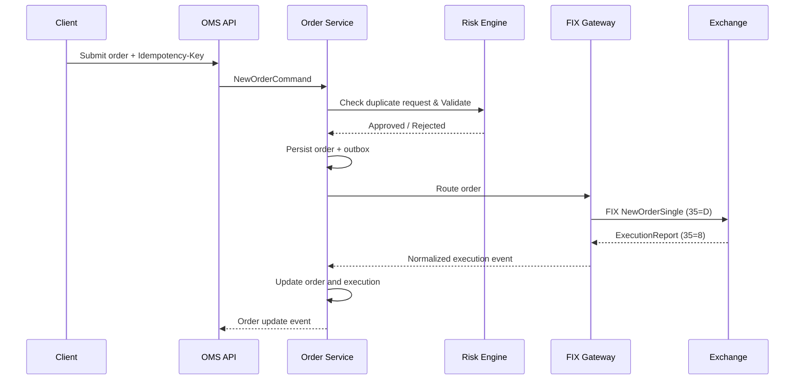

# Multi-Exchange OMS — Technical Specification & Engineering Backlog

**Architecture baseline finalized**  
**Engineering specification v1.0**

**Project:** Multi-Exchange Order Management System  
**Primary language:** Java  
**Framework:** Spring Boot + LangChain4j  
**Protocols:** FIX + FAST + ITCH  
**Architecture:** Modular monolith with independently deployable connectivity and market-data gateways  
**Users:** Institutional brokers, dealers, retail clients, and operations teams  
**AI:** Market research, analytics, operational assistance, and human-approved workflows  

> The specification below treats this as a reusable trading platform, not a CSE-BD-specific application. CSE-BD will be the first exchange adapter, but exchange-specific behavior must not leak into the OMS domain.
> 
> **The central architectural principle is:**  
> *One unified OMS domain, multiple exchange adapters, independent market-data pipelines, and an isolated AI subsystem. Neither the LLM nor the message broker will be allowed to become a dependency of the synchronous order-routing path.*

---

## 1. Final Architecture Decisions

| Area | Final decision |
| :--- | :--- |
| **Exchange support** | Multi-exchange |
| **FIX** | Client and server |
| **Market data** | FAST and ITCH |
| **Exchange integration** | Pluggable adapters |
| **Architecture** | Modular monolith |
| **Connectivity deployment** | Independent gateway processes |
| **Users** | Institutional + retail |
| **Order management** | Centralized OMS |
| **Risk management** | Synchronous deterministic risk engine |
| **Database** | PostgreSQL |
| **Cache** | Redis |
| **Event distribution** | Kafka / Redpanda |
| **FAST decoder** | OpenFAST |
| **FIX engine** | QuickFIX/J |
| **ITCH decoder** | Custom exchange-version-aware Java decoder |
| **AI** | LangChain4j |
| **AI permissions** | Read-only by default; human-approved actions |
| **Deployment** | Linux, Docker, private cloud |
| **Observability** | Prometheus, Grafana, OpenTelemetry |

### 1.1 Architectural Boundaries
There are four major execution domains:
- **Domain A: Trading Core** — Orders, risk, executions, positions, balances, allocations, and reconciliation.
- **Domain B: Exchange Connectivity** — FIX client/server sessions, exchange adapters, FAST decoders, ITCH decoders, and feed recovery.
- **Domain C: Client Platform** — Retail trading APIs, institutional APIs, administration, dashboards, and reporting.
- **Domain D: AI Intelligence** — LangChain4j, market research, RAG, operational diagnostics, analytics, and approved workflow proposals.

---

## 2. Detailed Logical Architecture

### 2.1 Deployment Architecture
The application will be one Maven multi-module codebase, but it will not run as one giant process.

| Deployment unit | Responsibilities | Scaling strategy |
| :--- | :--- | :--- |
| `oms-core` | Orders, risk, execution, positions | Horizontal, partitioned by account |
| `oms-client-api` | Retail and institutional APIs | Horizontal |
| `oms-fix-initiator` | Outbound FIX sessions to exchanges/brokers | Per counterparty/session group |
| `oms-fix-acceptor` | Inbound FIX client sessions | Horizontal with session ownership |
| `oms-marketdata-fast` | FAST feed reception and decoding | Per feed/channel |
| `oms-marketdata-itch` | ITCH reception and decoding | Per feed/channel |
| `oms-marketdata-distributor` | Normalized market-data distribution | Horizontal |
| `oms-admin` | Configuration, administration, reporting | Horizontal |
| `oms-ai` | LangChain4j, RAG, and AI workflows | Independent scaling |

**Network Architecture:**
```text
              EXCHANGE NETWORK
                     |
       +-------------+-------------+
       |                           |
  FIX Connections              Market Data
       |                           |
  FIX Gateway               Feed Receivers
       |                     /          \
       |                  FAST          ITCH
       |                   |             |
       |                   +------+------+
       |                          |
       |                    Normalization
       |                          |
       +------------+-------------+
                    |
              OMS Internal APIs
                    |
           +--------+---------+
           |                  |
        OMS Core           Event Bus
           |                  |
        PostgreSQL         Analytics
           |                  |
           +--------+---------+
                    |
                AI Layer
```
*Network isolation:* FIX order traffic, multicast feed traffic, management APIs, and AI provider traffic should use separate network policies. AI services must not have direct access to exchange sockets or FIX session credentials. For cloud deployments without multicast support, the feed receiver should relay authorized market-data traffic over a reliable unicast tunnel.

### 2.2 Multi-Exchange Adapter Architecture
Every exchange must implement a common set of interfaces. Exchange-specific behavior must not leak into the domain layer.

```java
public interface ExchangeAdapter {
    String exchangeCode();
    OrderProtocolAdapter orderProtocol();
    MarketDataAdapter marketData();
    InstrumentMetadataProvider instruments();
    TradingCalendar tradingCalendar();
    ExchangeCapabilities capabilities();
}

public interface OrderProtocolAdapter {
    void connect();
    void submit(NewOrderCommand command);
    void cancel(CancelOrderCommand command);
    void replace(ReplaceOrderCommand command);
    void requestStatus(String clientOrderId);
    void disconnect();
}

public interface MarketDataAdapter {
    void start();
    void stop();
    void recover(long lastProcessedSequence);
    MarketDataHealth health();
}
```

---

## 3. Domain Model and Order Management Specification

### 3.1 Core Domain Entities
```text
Organization
   |
   +--- Broker / Dealer
   |       |
   |       +--- Trading Accounts
   |       |       |
   |       |       +--- Orders
   |       |       +--- Executions
   |       |       +--- Positions
   |       |       +--- Risk Limits
   |       |
   |       +--- Institutional Clients
   |
   +--- Retail Clients
           |
           +--- Trading Accounts
```

**Supported Order Types:**
| Category | Initial support |
| :--- | :--- |
| Market, Limit, Day | Yes |
| Stop, Stop-limit, IOC, FOK, GTC | Exchange-dependent |
| Iceberg, Pegged | Future phase |

**Order State Machine:**
| State | Meaning |
| :--- | :--- |
| `RECEIVED` | OMS accepted API request |
| `VALIDATING` | Pre-trade validation |
| `REJECTED_LOCAL` | Failed local validation |
| `PENDING_NEW` | Submitted to exchange |
| `NEW` | Exchange acknowledged |
| `PARTIALLY_FILLED` | Part of quantity executed |
| `PENDING_CANCEL` / `PENDING_REPLACE` | Request sent, awaiting confirmation |
| `FILLED` / `CANCELED` | Exchange confirmed |
| `REJECTED_EXCHANGE` / `EXPIRED` | Terminal negative states |
| `UNKNOWN` | Exchange state requires reconciliation |

### 3.2 Order Identity and Idempotency
- `order_id`: Internal immutable OMS identifier.
- `cl_ord_id`: Client-originated order identifier (unique within client/exchange scope).
- `exchange_order_id`: Exchange-assigned order identifier.
- `root_order_id` / `parent_order_id`: Supports order hierarchy.
- `orig_cl_ord_id`: Identifies the previous order version during cancel/replace.
- `exec_id`: Identifies an execution.

### 3.3 Order Processing Sequence

*Note:* The outbox ensures that a committed order and its corresponding integration event cannot silently diverge. Do not rely on asynchronous Kafka consumption to decide whether an order passes risk checks.

---

## 4. Database Specification

### 4.1 Database Design
- **PostgreSQL**: Authoritative trading records.
- **Redis**: Sessions, caches, market snapshots.
- **Kafka/Redpanda**: Durable asynchronous events.
- **Object Storage**: Raw feed captures, archived FIX logs, reports.
- **Vector Database**: AI documentation retrieval.

*Recommended schema namespaces:* `identity`, `reference`, `trading`, `execution`, `risk`, `connectivity`, `marketdata`, `audit`, `ai`.

### 4.2 Main Database Tables
| Table | Important fields | Purpose |
| :--- | :--- | :--- |
| `reference.exchanges` | id, code, name, timezone | Exchange registry |
| `reference.instruments` | id, symbol, instrument_type, currency | Instrument master |
| `trading.accounts` | id, organization_id, account_type, status | Trading accounts |
| `trading.orders` | id, account_id, cl_ord_id, status, version | Current order state |
| `trading.order_events` | id, order_id, event_type, event_sequence, payload | Immutable lifecycle |
| `execution.executions` | id, order_id, exec_id, price, quantity | Trade executions |
| `risk.risk_limits` | account_id, instrument_id, max_quantity, max_exposure | Risk controls |
| `connectivity.fix_sessions` | id, exchange_id, sender_comp_id, target_comp_id | FIX sessions |
| `trading.outbox_events` | id, aggregate_id, event_type, payload, published_at | Reliable events |

### 4.3 Core SQL DDL (Baseline)
```sql
CREATE SCHEMA IF NOT EXISTS reference;
CREATE SCHEMA IF NOT EXISTS trading;
CREATE SCHEMA IF NOT EXISTS execution;
CREATE SCHEMA IF NOT EXISTS risk;
CREATE SCHEMA IF NOT EXISTS connectivity;

CREATE TABLE trading.orders (
    id UUID PRIMARY KEY,
    account_id UUID NOT NULL REFERENCES trading.accounts(id),
    exchange_id UUID NOT NULL REFERENCES reference.exchanges(id),
    instrument_id UUID NOT NULL REFERENCES reference.instruments(id),
    cl_ord_id VARCHAR(64) NOT NULL,
    exchange_order_id VARCHAR(64),
    side VARCHAR(8) NOT NULL,
    order_type VARCHAR(24) NOT NULL,
    time_in_force VARCHAR(16) NOT NULL,
    quantity BIGINT NOT NULL,
    limit_price NUMERIC(24, 10),
    filled_quantity BIGINT NOT NULL DEFAULT 0,
    status VARCHAR(32) NOT NULL,
    version INTEGER NOT NULL DEFAULT 1,
    created_at TIMESTAMPTZ NOT NULL DEFAULT now(),
    updated_at TIMESTAMPTZ NOT NULL DEFAULT now(),
    UNIQUE(account_id, exchange_id, cl_ord_id)
);

CREATE TABLE trading.outbox_events (
    id UUID PRIMARY KEY,
    aggregate_type VARCHAR(64) NOT NULL,
    aggregate_id UUID NOT NULL,
    event_type VARCHAR(100) NOT NULL,
    payload JSONB NOT NULL,
    created_at TIMESTAMPTZ NOT NULL DEFAULT now(),
    published_at TIMESTAMPTZ
);

CREATE INDEX idx_outbox_unpublished ON trading.outbox_events(created_at) WHERE published_at IS NULL;
```
**Additional Requirements:** Partition `order_events` and `audit_logs` by time. Use optimistic locking for concurrent order modifications. Enforce execution uniqueness. Never allow AI services to write directly to trading tables.

---

## 5. API Specification
Base path: `/api/v1`

### 5.1 Order APIs
| Method | Endpoint | Description |
| :--- | :--- | :--- |
| `POST` | `/orders` | Create order (requires `Idempotency-Key` header) |
| `GET` | `/orders/{id}` | Get order details |
| `POST` | `/orders/{id}/cancel` | Request cancellation |
| `POST` | `/orders/{id}/replace` | Request modification |

### 5.2 Market-Data APIs
| Method | Endpoint | Description |
| :--- | :--- | :--- |
| `GET` | `/marketdata/{exchange}/{symbol}/quote` | Best bid/offer |
| `GET` | `/marketdata/{exchange}/{symbol}/book` | Order book |
| `WS` | `/api/v1/stream/marketdata` | Live market-data updates |

*Every market-data response must include:* Exchange timestamp, local receive timestamp, feed sequence, exchange identifier, and data quality/staleness status.

### 5.3 AI APIs
| Method | Endpoint | Description |
| :--- | :--- | :--- |
| `POST` | `/ai/chat` | OMS operations assistant |
| `POST` | `/ai/proposals/{id}/approve` | Human approval for AI-generated trading proposals |

---

## 6. FIX Protocol Specification

### 6.1 FIX Architecture
- **FIX Initiator:** OMS connects to an exchange, broker, or liquidity provider.
- **FIX Acceptor:** OMS listens for incoming FIX connections from institutional clients.
- **Recommended Engine:** QuickFIX/J.

### 6.2 Session Configuration Model
A FIX session is uniquely identified by: `BeginString`, `SenderCompID`, `TargetCompID`, `SessionQualifier`.
Required settings include: `exchange_id`, `connection_role`, `heartbeat_interval`, `dictionary_path`, `store_path`, `tls_enabled`, and `reset_policy`.

### 6.3 FIX Message Mapping
| Message | FIX Type | OMS Operation |
| :--- | :--- | :--- |
| Logon / Logout | A / 5 | Establish / Close session |
| NewOrderSingle | D | Submit order |
| ExecutionReport | 8 | Process acknowledgement/execution |
| OrderCancelRequest | F | Cancel order |
| OrderCancelReplaceRequest | G | Replace order |

### 6.4 Session Recovery and Failover
FIX session state must be durable. The adapter must:
1. Persist incoming and outgoing sequence numbers.
2. Detect sequence gaps and issue `ResendRequest` (tag 2).
3. Process `PossDupFlag` retransmissions idempotently.
4. Reconcile open orders after reconnect.
5. Never blindly resend a `NewOrderSingle` just because a TCP connection failed.

---

## 7. FAST and ITCH Market-Data Specification

### 7.1 Market-Data Architecture
```text
                  EXCHANGE FEEDS
                        |
              +---------+---------+
              |                   |
           FAST Feed           ITCH Feed
              |                   |
         Packet Handler      Packet Handler
              |                   |
         Sequence Check      Sequence Check
              |                   |
         OpenFAST Decoder    ITCH Decoder
              |                   |
              +---------+---------+
                        |
                  Normalization
                        |
                  MarketDataEvent
```

### 7.2 FAST Processing Design
- **Stages:** Feed receiver → Packet validator → Sequence tracker → Template manager → FAST decoder → Normalizer.
- **Integration:** Use OpenFAST. The decoder must handle template ID changes, optional fields, presence maps, delta/copy operators, and feed sequence gaps.

### 7.3 ITCH Processing Design
- Implement as a versioned binary protocol adapter (e.g., Nasdaq TotalView-ITCH 5.0).
- Avoid reflection and unnecessary object allocation in the hot path. Use preallocated buffers and explicit field readers.

### 7.4 Unified Market-Data Event Contract
```java
public record MarketDataEvent(
    String exchange,
    String feedChannel,
    String instrument,
    MarketEventType eventType,
    long exchangeSequence,
    long exchangeTimestamp,
    long receiveTimestamp,
    String orderId,
    Side side,
    long priceTicks,
    long quantity,
    String currency
) {}
```

### 7.5 Order-Book Reconstruction
- Support L1 (BBO), L2 (Aggregated depth), and L3 (Order-level depth).
- **Invariants:** An execution cannot exceed remaining quantity. A sequence gap invalidates confidence in the incremental book; the system must mark the book stale and recover from a valid snapshot before declaring it synchronized.

---

## 8. Risk Management Specification

### 8.1 Pre-Trade Risk Checks
- Account status, instrument status, market session.
- Quantity/price validity (tick size, lot size).
- Available funds, position limits, order value limits.
- Duplicate request (idempotency enforced).

### 8.2 Risk Calculation
For a simple cash-equity buy order:
$$ \text{Order Value} = \text{Quantity} \times \text{Limit Price} $$
$$ \text{Available Funds} = \text{Cash Balance} - \text{Existing Reservations} $$
$$ \text{New Reservation} = \text{Order Value} + \text{Estimated Fees} $$
*Use decimal-safe monetary calculations.*

### 8.3 Kill-Switch Hierarchy
Global Trading → Exchange → Broker/Organization → Account → Instrument.  
Kill switches must be enforceable by the trading core synchronously, without depending on Kafka, Redis, or AI.

---

## 9. LangChain4j AI Specification

### 9.1 AI Module Architecture
The AI subsystem is isolated. It uses read-only tools to query the OMS and can only generate *proposals* that require human approval.

### 9.2 Three AI Capabilities
1. **OMS Operations Assistant:** Answers questions about order status, FIX session health, and risk breaches using authorized OMS query services.
2. **Market Research and Analytics:** Generates summaries of market movements, volume analysis, and historical execution data.
3. **AI-Assisted Trading Workflow:** Interprets natural-language requests, constructs proposed orders, explains risk implications, and creates a pending proposal for human approval.

### 9.3 AI Tool Design
```java
@Component
public class OmsReadTools {
    @Tool("Retrieve an OMS order")
    public OrderDto getOrder(String orderId) {
        return orderQuery.findAuthorized(orderId);
    }
    // Tools are strictly read-only.
}
```

### 9.4 AI Security Requirements
- Separate AI database credentials.
- Read-only access to live OMS data with explicit tenant/account filtering.
- Prompt-injection protection and PII redaction.
- Immutable audit trail for all AI proposals and human approvals.

---

## 10. Engineering Backlog and Sprint Plan

**Estimated Duration:** 22 weeks  
**Team Size:** 6–8 engineers  
**Sprint Length:** 2 weeks  

### 10.1 Key Epics
- **EPIC-01 to 03:** Platform foundation, Identity, Exchange adapter framework.
- **EPIC-04 to 05:** FIX initiator and acceptor.
- **EPIC-06 to 08:** FAST, ITCH, and Market-data normalization.
- **EPIC-09 to 11:** Order management, Risk, Execution, and reconciliation.
- **EPIC-12:** Institutional and retail APIs.
- **EPIC-13 to 15:** AI assistant, research, and workflows.
- **EPIC-16 to 17:** Observability, resilience, deployment, and certification.

### 10.2 Definition of Done
Every production-bound item must have: Unit tests, integration tests, input validation, structured logs/metrics, error/recovery handling, security checks, documentation, code review, and CI pipeline passing.

---

## 11. Testing and Acceptance Specification

### 11.1 Performance Benchmarks (Initial Targets)
| Component | Target |
| :--- | :--- |
| Local order validation | P99 under 5 ms |
| Internal FIX gateway processing | P99 under 5 ms |
| FAST / ITCH decode | P99 under 1 ms/message |
| Order-book update | P99 under 1 ms/event |
| AI assistant | P95 under 5 seconds |

### 11.2 Failure Scenarios
| Scenario | Expected behavior |
| :--- | :--- |
| FIX connection drops | Reconnect and recover according to venue rules |
| Market-data packet lost | Mark book stale and recover |
| PostgreSQL unavailable | Stop accepting uncommittable orders |
| AI provider unavailable | OMS continues normal trading |

---

## 12. Deployment and Infrastructure Specification

### 12.1 Production Deployment
Start with Linux VMs and Docker Compose or a lightweight container orchestration platform. Separate networks for Client APIs, OMS Core, Connectivity (FIX/Market Data), and AI.

### 12.2 Infrastructure Sizing (Initial Estimates)
| Component | Initial allocation |
| :--- | :--- |
| OMS Core | 8 vCPU, 16 GB RAM |
| FIX Gateway | 4 vCPU, 8 GB RAM per gateway |
| FAST / ITCH Gateway | 8 vCPU, 16 GB RAM |
| PostgreSQL | 8 vCPU, 32 GB RAM |
| Kafka | 3 nodes, 4–8 vCPU each |

### 12.3 Disaster Recovery
- **OMS database RPO:** 5 minutes or better.
- **OMS core RTO:** 30 minutes.
- **FIX session recovery:** Automatic where supported.
- **Topology:** Primary/standby gateways with independent recovery and explicit session ownership (no active-active sending on the same CompID).

---

## 13. Project Deliverables
1. Architecture specification & Maven multi-module repository.
2. Database schema and Flyway migrations.
3. REST/OpenAPI documentation.
4. FIX, FAST, and ITCH decoders and gateways.
5. Market-data normalization and L1/L2/L3 order-book engine.
6. OMS order, risk, and execution engine.
7. LangChain4j AI assistant and workflow engine.
8. Automated test suite, deployment scripts, and operational runbooks.

---

## 14. Main Project Risks and Dependencies
| Risk | Impact | Mitigation |
| :--- | :--- | :--- |
| Exchange specifications unavailable | Blocks adapters | Obtain specifications before implementation |
| No FIX certification environment | Blocks order integration | Build simulator and arrange exchange testing |
| Multicast unavailable in cloud | Feed delivery failure | Edge feed relay |
| FAST templates change | Decoder failure | Versioned template registry |
| LLM hallucination | Incorrect operational decisions | Deterministic data tools and human approval |

---

## 15. Recommended Final Technology Baseline
| Component | Final selection |
| :--- | :--- |
| **Language / Framework** | Java 21 LTS, Spring Boot 3.5.x |
| **Build / CI** | Maven, Git-based pipelines |
| **Protocols** | QuickFIX/J, OpenFAST, Custom ITCH decoder |
| **Data / Cache** | PostgreSQL, Flyway, Redis |
| **Messaging** | Kafka / Redpanda, Disruptor (internal low-latency) |
| **AI** | LangChain4j + Vector Store |
| **Observability** | Micrometer, Prometheus, Grafana, OpenTelemetry |

---

## 16. Final Project Execution Recommendation
**Implementation Priority:**
1. Exchange adapter framework.
2. FIX initiator and acceptor.
3. FAST and ITCH ingestion.
4. Unified market-data and order-book engine.
5. OMS and risk engine.
6. Retail and institutional APIs.
7. AI assistant, research, and approved workflows.
8. Certification, performance, and production release.

---

## 17. Five Decisions Still Needed Before Coding Begins
1. **Initial exchange adapters:** CSE-BD and DSE, then international exchanges.
2. **Initial asset class:** Equities.
3. **Market-data depth:** L1/L2/L3 where supplied.
4. **FIX client onboarding:** One isolated session per client/counterparty.
5. **Production topology:** Primary/standby gateways with independent recovery.

---

## 18. Technical Reference Documentation
1. [LangChain4j Spring Boot Integration](https://docs.langchain4j.dev/tutorials/spring-boot-integration/)
2. [QuickFIX/J Configuration](https://quickfixj.org/docs/configuration/)
3. [FIX Trading Community — Session Layer](https://fixtrading.org/standards/fixsession/)
4. [Nasdaq TotalView-ITCH 5.0 Specification](https://www.nasdaqtrader.com/content/technicalsupport/specifications/dataproducts/Totalview-ITCH-cloud.pdf)
5. [FIX Session Layer Technical Standard](https://www.fixtrading.org/wp-content/uploads/download-manager-files/FIX_Session_Layer_June_2020.pdf)

> **Next Engineering Milestone:** Build the Maven repository, domain interfaces, exchange simulator, and the first FIX initiator/acceptor vertical slice. This provides a functioning foundation before investing in all market-data adapters and AI capabilities.
